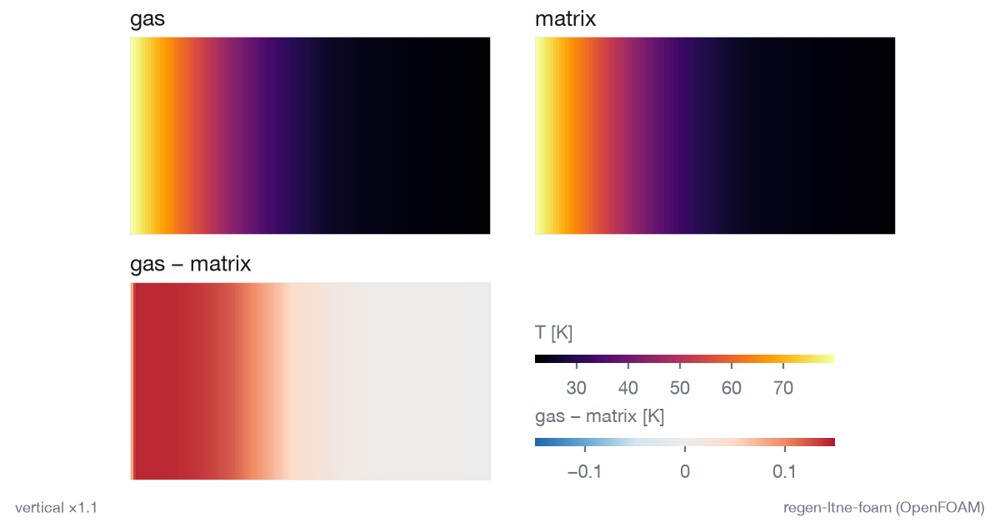
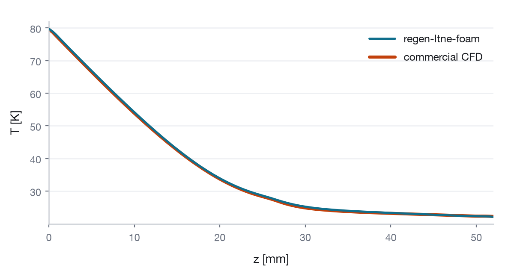

# regen-ltne-foam

[](https://doi.org/10.5281/zenodo.23499221)

`ltneFoam`: an OpenFOAM solver for compressible, oscillating (piston-driven) helium flow through porous media with
local thermal non-equilibrium (LTNE). It is `rhoPimpleFoam` plus porosity-weighted storage terms, a solid-matrix
energy equation coupled to the gas by `h_sf a_sf (T_s - T_g)`, and a prescribed piston motion. Darcy-Forchheimer
drag coefficients are read from the standard `explicitPorositySource` entries and balanced on faces in the pressure
equation, with the cell velocity reconstructed from face fluxes (`docs/L2_FIX_DESIGN.md`). Reference model: Tew et al. 2006, NASA/TM (Fluent porous-media LTNE).
Acceptance bars: `docs/VERIFICATION.md`. Release notes: `docs/RELEASE_NOTES.md`. New cases: `docs/NEW_CASE.md`.

## Results at a glance



Gas temperature, matrix temperature and their difference in a wire-mesh regenerator, end of cycle 80 of a 2-D
axisymmetric wedge variant of the L5 slice (mirrored about the axis for display; the wedge case is not yet in this
repository). The gas-minus-matrix field is what an LTNE model resolves and a single-temperature porous model cannot.



Cycle-mean axial gas temperature from `ltneFoam` (L5 slice set to the reference geometry, cycle 40) against a 2-D
axisymmetric commercial CFD reference of the same regenerator.

## Distribution: OpenFOAM v2512 (openfoam.com, OpenCFD/ESI), apt package `openfoam2512-dev` 2512.0-2

- `rhoPimpleFoam` is still a classic, self-contained application in this distribution, so the solver is a short
  diff against a standard solver (`src/ltneFoam`). In openfoam.org v11+ the solvers are modules of `foamRun`, and the
  API changes between yearly versions.
- The Darcy-Forchheimer model (`d` = 1/permeability, `f` = C2) takes the same coefficients as Fluent's porous zone,
  which helps a comparison with Fluent results.
- Official binary packages for Ubuntu 22.04/24.04 with a pinned version make `tools/install.sh` reproducible, and
  one six-monthly release is supported for years.

## Piston motion

`src/pistonMotion` (`motionSolver pistonLinear`) moves the mesh points between each piston face and a fixed plane
linearly along the axis. Nothing moves outside the piston spaces, so porous zones stay stationary, and there is no
topology change or field mapping. This is used instead of layer addition/removal. Cell heights in the piston space
are h0 (1 - x_p / length), so the amplitude must stay below the piston-space length. Measured limit (L1 run d,
`results/L1`): at amplitude / piston-space length = 0.488, as in L5, the cell heights range from 0.512 to 1.488 h0. The
pressure amplitude is within 2.6e-6 of the isentropic lumped result, mass closure per cycle is 2.2e-14 and energy
closure 8.2e-6. Works for 1-D and 2-D axisymmetric (wedge) meshes with an axial piston.

## Limitations

Darcy-Forchheimer drag must be isotropic (`explicitPorositySource`, `DarcyForchheimer`); an anisotropic model, or any
other fvOption acting on U, stops with a fatal error. The transonic pressure formulation is not supported (fatal
error). Solid properties are constant.

## Install and build (Ubuntu 22.04 or 24.04)

    sudo tools/install.sh
    source /usr/lib/openfoam/openfoam2512/etc/bashrc     # in every new shell

`tools/install.sh` adds the openfoam.com apt repository, installs `openfoam2512-dev=2512.0-2` and runs
`src/Allwmake`.

## macOS and Windows: Docker

`docker/Dockerfile` is Ubuntu 24.04 with the same OpenFOAM package (`openfoam2512-dev=2512.0-2`). The image was
tested natively on arm64 (Apple silicon); CI runs the same package on x86-64 without Docker. `docker/run.sh` builds the image on first use, mounts the
repository, compiles the solver and runs one level:

    docker/run.sh L3                # results in out/L3; any level: L0-L4 (minutes), L5, L6 (hours)

On Windows, run it from a WSL2 shell with Docker Desktop. Measured natively on Apple silicon (arm64), one core: L0
8/8, L3 10/10, L4 6/6, and L5 11/12 + L5.7a, identical to CI, at about 15 s per L5 cycle.

## Optional real-gas helium

The default gas is the ideal gas of each case. The optional real-gas model (library `ltneRealGas`) takes density,
enthalpy, c_p, c_v, entropy, viscosity and conductivity as functions of T and p from a CoolProp table. The table is
`src/ltneRealGas/tables/helium_CoolProp.dat`, for 15-95 K and 0.5-1.0 MPa, generated by
`tools/heliumRealGas/genHeliumTable.py`. Switch an L5-type case with `mkCase.py <case> --gas real`. The case runs
with `libs (ltneRealGas);` in its controlDict and needs no change to the solver. Level LP checks the density and
c_p against NIST in CI (`docs/VERIFICATION.md`, LP).

## Run a level

    tools/run_level.sh L0 results/L0    # Allclean, Allrun, extract metrics, Allclean, check bars

Or by hand: `cases/<level>_*/Allrun`, `cases/<level>_*/Allclean`. `tools/verify.py` compares
`<outdir>/results.csv` (every value with its file and line) with the bars and writes `<outdir>/STATUS.md`. CI
(`.github/workflows/verify.yml`) does the same on every pull request for each level in `tools/ci_levels.txt`.
The long levels (L5, L6) run with `cases/<level>_*/runLong.sh <outdir>`, or through `.github/workflows/run-case.yml`.

## Status

| level | case | status |
|---|---|---|
| L0 build + smoke | `cases/L0_smoke` | PASS (8/8, merged) |
| L1 closed tube, piston | `cases/L1_closedTube` | PASS (15/15, merged) |
| L2 porous plug, steady | `cases/L2_porousPlug` | PASS (16/16 after the face-consistent drag fix, merged; first run FAIL 12/16 in `results/L2_run1`) |
| L3 LTNE relaxation | `cases/L3_ltneRelax` | PASS (10/10, merged) |
| L4 LTNE with flow | `cases/L4_singleBlow` | PASS (6/6, merged; first run crashed on a k_s = 0 bug, `results/L4_run1`) |
| L5 regenerator slice | `cases/L5_regenSlice` | 11/12 PASS as preregistered (L5.7 FAIL); supplementary check L5.7a PASS (Amendment A1) (`results/L5`); the code-to-code comparison with ANSYS Fluent (B1-B4) is not part of this release |
| L6 verification of L5 (grid, time step, periodicity) | `cases/L6_regenConvergence` | 17/21 PASS as preregistered: periodicity, GCI_fine < 3 % and dt/2 < 1 % pass; the apparent-order check fails for 4 of 5 QoIs (`results/L6`) |
| L5D decay ratio of the slow matrix thermal relaxation (L5 slice) | `cases/L5D_decayRatio` | measured, no bar: r = 0.99670 per cycle (tau = 302 cycles = 13.2 s) over 600 cycles; crash and Allclean checks PASS (`results/L5D`) |
| LP real-gas helium properties (optional model) | `cases/LP_heliumRealGas` | see `results/LP` |

Scope:
- L0-L4 are verified against exact or analytical solutions (L0 is the build and smoke test).
- L5 is a check of numerical self-consistency: energy closure, periodicity, and grid and time-step sensitivity.
- L6 is a grid and time-step convergence study of the L5 model (a verification of the numerics, not of the model).
- The code-to-code comparison with Fluent (bars B1-B4) has not been done yet, and nothing in this repository has
  been validated against experiments.
- The L5 energy-closure checks (B5 as L5.7, and L5.7a) test the closure of the model's own energy balance. They
  cannot detect heat losses that the model does not contain, such as the outer wall or the end faces.

## How to cite

Dr Qiming Yu, Enterprise Research Fellow, University of Southampton.

Machine-readable metadata: [CITATION.cff](CITATION.cff) (GitHub's "Cite this repository" uses it). BibTeX:

```bibtex
@software{yu_regen_ltne_foam,
  author  = {Yu, Qiming},
  title   = {regen-ltne-foam: ltneFoam, an OpenFOAM solver for oscillating helium flow in porous
             regenerators with local thermal non-equilibrium},
  version = {1.0.2},
  license = {GPL-3.0-or-later},
  doi     = {10.5281/zenodo.23499221},
  url     = {https://github.com/alexyu2024/regen-ltne-foam}
}
```

Concept DOI (all versions): [10.5281/zenodo.23499221](https://doi.org/10.5281/zenodo.23499221).

## License and rights

Copyright (C) 2026 Qiming Yu <qimingyu.alex@gmail.com>
Enterprise Research Fellow, University of Southampton.

This program is free software: you can redistribute it and/or modify it under the terms of the
GNU General Public License as published by the Free Software Foundation, either version 3 of the
License, or (at your option) any later version. It is distributed in the hope that it will be
useful, but WITHOUT ANY WARRANTY; without even the implied warranty of MERCHANTABILITY or FITNESS
FOR A PARTICULAR PURPOSE. See [LICENSE](LICENSE).

This offering is not approved or endorsed by OpenCFD Limited, producer and distributor of the
OpenFOAM software via www.openfoam.com, and owner of the OPENFOAM(R) and OpenCFD(R) trade marks.
`ltneFoam` is an independent solver built on the OpenFOAM(R) libraries (ESI / openfoam.com
distribution).

### Authorship, Scientific Leadership & AI Disclosure

**Scientific Direction & Principal Investigator:** Qiming Yu (Enterprise Research Fellow, University of Southampton)
- **Conception & Physics:** Conceived the project and defined the scientific objective (an open-source LTNE
  regenerator solver succeeding previous Fluent formulations). Selected the governing thermal non-equilibrium
  transport model (reference model: Tew et al. 2006, the Fluent porous-media LTNE formulation) and the regenerator
  problem and its parameters (Huang et al. 2020).
- **Verification Architecture:** Architected the graded verification methodology (L0-L6), required every
  acceptance threshold to be fixed before the simulation runs to ensure falsification integrity, set the L5 and L6
  thresholds and accepted those of L0-L4, and established the energy-ledger / GCI assessment framework.
- **Scientific Rulings:** Specified the physical closure models (`cases/L5_regenSlice/params_L5.yaml`) and
  adjudicated all numerical closure proposals and technical ambiguities across pull requests (including the
  face-consistent Darcy-Forchheimer treatment in `docs/L2_FIX_DESIGN.md`). Holds sole scientific responsibility for
  the codebase and its physical validity.

**AI Implementation Assistance:** Anthropic Claude (Claude Code)
- Operating under the author's continuous direction, mathematical specification and code review, Claude acted as
  an agentic co-development tool to draft and implement the OpenFOAM C++ solver, the benchmark set-ups, the
  acceptance-bar drafts and the CI automation scripts.
- Claude assisted in diagnosing run failures and proposed and implemented numerical treatments (e.g. the
  flux-reconstructed velocity, the L4 Schumann test-case proposal and the ledger scripts). All contributions are
  auditable through the commit history and pull requests.
- All implementations were reviewed and accepted by the author. L0-L4 are re-checked by CI against published
  closed-form benchmarks. L5 and L6 are recorded self-consistency and convergence runs, with their outcomes,
  including the recorded FAILs, under Status (see `docs/VERIFICATION.md`). This does not mean that L5 has been
  verified against Fluent, or that anything has been validated against experiments.

The verification cases use published, public-domain data only. If you use this solver in academic work, please
cite this repository (a paper reference will be added when available).
